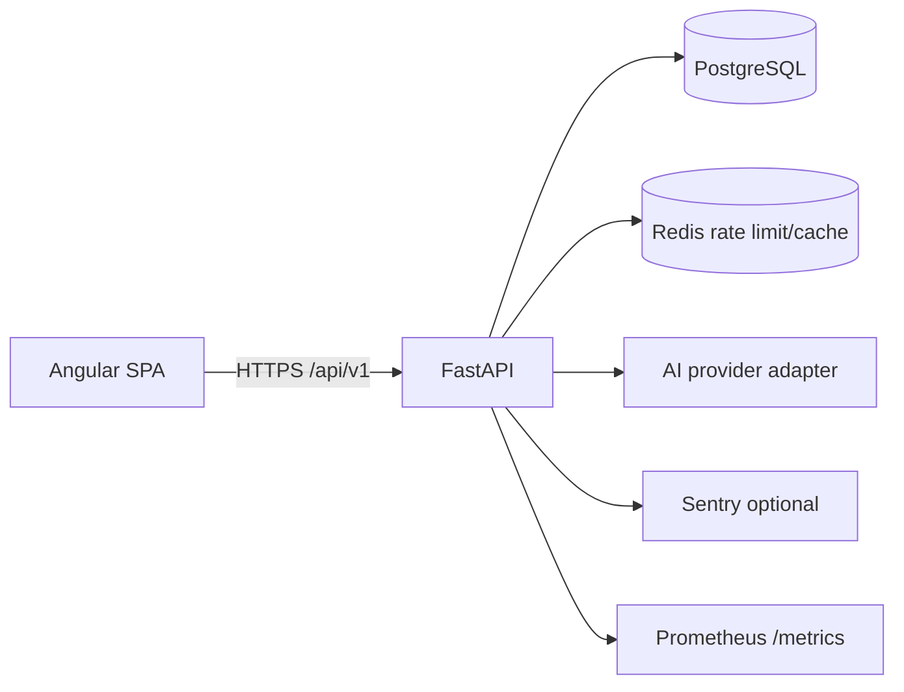
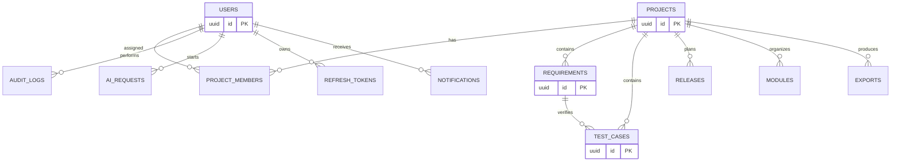

# CaseCraft QA

CaseCraft QA is an AI-assisted test design workspace for turning requirements into reviewable, traceable test cases. The repository contains an Angular 20 client and a FastAPI service, backed by PostgreSQL and Redis.

## What is implemented

- JWT access tokens, rotating opaque refresh tokens, role checks, Argon2 password hashing, CSRF protection on refresh/logout, and configurable CORS.
- Projects and requirements with secure document parsing for PDF, DOCX, TXT, CSV, and XLSX.
- AI-provider abstraction (OpenAI-compatible today) with structured generation, validation, persisted request records, and deduplication within generated batches.
- Test-case CRUD, filtering, pagination, audit history, and CSV/XLSX/PDF exports.
- Dashboard summary, responsive dark/light Angular workspace, Docker Compose, CI, API tests, and Playwright smoke coverage.

The platform deliberately fails explicitly when an AI key or required service is unavailable. Configure providers and secrets before deploying; this repository does not include credentials or hosted infrastructure.

## Scope and production gaps

This is a working product baseline, not a claim that every item in the requested enterprise backlog is already delivered. Email delivery, encrypted object storage/retention, password reset and invitation flows, Grafana dashboards, durable background jobs, test-case trend reporting, and complete project/release/module administration screens are not implemented. The dashboard's defect-prediction value is a transparent heuristic, not a trained model. Validate security controls, load behavior, and hosted deployment settings in a staging environment before production use.

## Architecture



The API is organized around API, application services, domain rules, and infrastructure adapters. SQLAlchemy models are the persistence boundary; Pydantic schemas are the request/response boundary. The Angular client uses standalone components, a typed API service, and signals for view state.

### Entity relationship diagram



## Repository structure

```text
backend/
  app/
    api/v1/          # REST routes and dependencies
    application/     # generation, parsing, export, auth services
    domain/          # shared domain policies
    infrastructure/  # AI adapter and database/session setup
    models/          # SQLAlchemy entities
    schemas/         # Pydantic contracts
  alembic/           # database migrations
  tests/             # unit and API integration tests
frontend/
  src/app/           # core service, shared UI and feature workspace
  e2e/               # Playwright smoke test
```

## Local development

Requirements: Docker Desktop, Node.js 20.19+ (or 22.12+), and Python 3.12+.

1. Copy `.env.example` to `.env`; set a long `JWT_SECRET_KEY` and an `OPENAI_API_KEY` to enable generation.
2. Start the API, PostgreSQL, Redis, and Angular development server:

   ```powershell
   docker compose up --build
   ```

3. Open `http://localhost:4200`. API docs are at `http://localhost:8000/docs`; readiness is `/health/ready`.
4. Create an account on the sign-in screen. The first registered user is an Admin; subsequent accounts are QA Engineers. An Admin can grant other roles through the user administration API.

For backend development without Docker:

```powershell
cd backend
python -m venv .venv
.\.venv\Scripts\Activate.ps1
pip install -e ".[dev]"
alembic upgrade head
uvicorn app.main:app --reload
```

For frontend development:

```powershell
cd frontend
npm ci
npm start
```

## API overview

All application endpoints are versioned under `/api/v1`; OpenAPI/Swagger is generated from the Pydantic contracts.

| Method | Route | Permission / purpose |
|---|---|---|
| POST | `/auth/register`, `/auth/login` | Register or obtain access token; refresh token is HttpOnly cookie |
| POST | `/auth/refresh`, `/auth/logout` | Rotate or revoke refresh token; CSRF header required |
| GET/POST | `/projects` | List or create projects |
| GET/POST | `/projects/{project_id}/requirements` | List or create requirements |
| PATCH/DELETE | `/requirements/{requirement_id}` | Update or delete a requirement |
| POST | `/projects/{project_id}/requirements/import` | Parse and import supported requirement documents |
| POST | `/requirements/{requirement_id}/generate` | Generate and persist test cases |
| GET/POST | `/projects/{project_id}/test-cases` | Filter/page or create cases |
| GET/PUT/PATCH/DELETE | `/test-cases/{case_id}` | Read/update/delete a case |
| GET | `/test-cases/{case_id}/history` | Audit history for a case |
| GET | `/projects/{project_id}/exports/{csv,xlsx,pdf}` | Download filtered project cases |
| GET | `/projects/{project_id}/dashboard` | Coverage, totals, duplicates and priority distribution |
| GET | `/auth/users` | Admin-only user listing |
| PATCH | `/auth/users/{user_id}/role` | Admin-only role management |

Test-case list accepts `page`, `page_size`, `priority`, `status`, `requirement_id`, `module`, `sprint`, and `q`. API errors use standard HTTP status codes and FastAPI's structured error response.

## Configuration and deployment

See [.env.example](.env.example). Production deployment should use managed PostgreSQL (for example Supabase), a managed Redis-compatible service, HTTPS, and secret-manager values. Deploy the Angular static build to Vercel and the API container to Render. The Vercel rewrite targets `https://casecraft-api.onrender.com`; update it if the Render service hostname changes. Set `FRONTEND_ORIGINS`, a SQLAlchemy-compatible `DATABASE_URL` (for example `postgresql+psycopg://...`), `REDIS_URL`, `JWT_SECRET_KEY`, `COOKIE_SECURE=true`, and AI provider configuration per environment. Render runs `alembic upgrade head` as its pre-deploy step before routing traffic.

`docker-compose.yml` is for local development; it does not expose a production deployment configuration or provision hosted services. Sentry and Prometheus metrics are opt-in through configuration. Grafana dashboard provisioning is deployment-specific. In-app notifications are persisted; SMTP email delivery is not implemented. Uploaded originals are parsed transiently and not retained; only extracted text and the source filename are stored, so connect an encrypted object-storage adapter before using this for long-term document retention.

### Production checklist

- Use unique managed secrets, TLS end-to-end, private database networking, backups, and tested restore procedures.
- Set tight CORS origins, `COOKIE_SECURE=true`, upload limits, and rate-limit settings; do not expose the database or Redis publicly.
- Run migration and CI checks before deploy; configure Sentry DSN and scrape `/metrics` from a private network.
- Configure mail delivery at the deployment layer before enabling outbound email notifications.

## Verification

```powershell
cd backend
pytest
ruff check .
```

```powershell
cd frontend
npm test -- --runInBand
npm run build
npx playwright test
```

The configured 80% coverage gates apply to backend application services and frontend API/auth services; they do not represent total application coverage. Integration tests exercise the main API workflow, while provider, mail, hosted database, and deployment integrations still need environment-backed staging verification.
